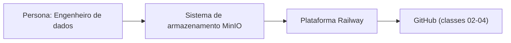
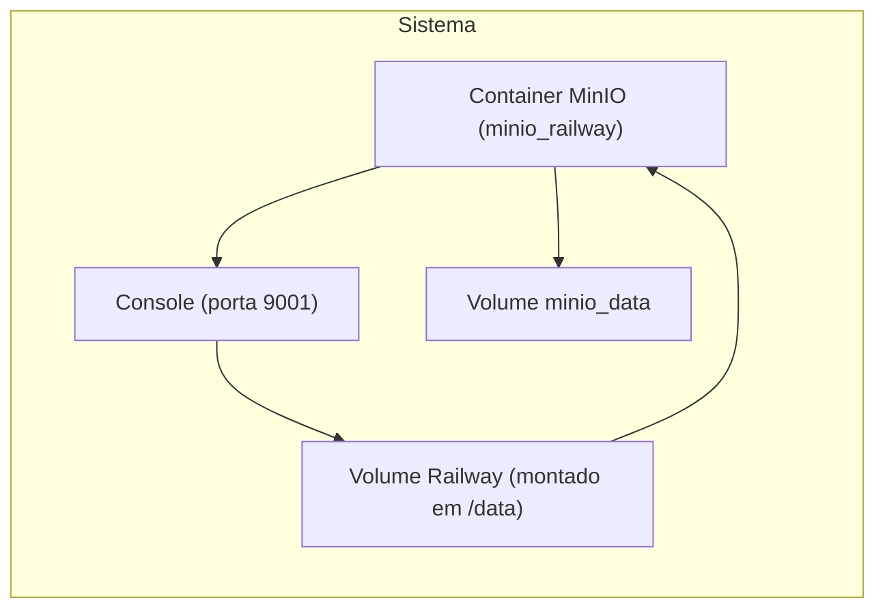

# Plano Técnico

## C4 nível 1: Contexto



## C4 nível 2: Contêineres



## C4 nível 3: Componentes do script de verificação

```mermaid
flowchart LR
  subgraph Verificação Local (l1-l3)
    c1["mc ready minio"] --> c2["mc ls minio"]
    c2 --> c3["mc cp raw/_verificacao/teste.json minio/"]
    c3 --> c4["mc get minio/raw/_verificacao/teste.json"]
  end
  subgraph Verificação Railway (r1-r4)
    c1["mc ready railway"] --> c2["mc ls railway"]
    c2 --> c3["mc cp raw/_verificacao/teste.json railway/"]
    c3 --> c4["mc get railway/raw/_verificacao/teste.json"]
  end
```

## Escolhas Técnicas

| Escolha | Alternativas Consideradas | Requisito/Restrição | ADR |
|---------|---------------------------|---------------------|------|
| Imagem do MinIO | imagem minio/minio antiga (sem segurança atualizada); latest da coolLabs (variável); compilar do código-fonte (demorado) | RF-07 (imagem fixada), RES-02 (tag fixada) | ADR-001 |
| Portas expostas | 9000 (API S3) e 9001 (console) | RF-01 (persistência entre deploys), RF-06 (acesso autenticado) | ADR-002 |
| Domínio público do Railway | domínio público para 9000, 9001 apenas local | RF-01 (persistência entre deploys), RF-06 (acesso autenticado) | ADR-002 |
| Armazenamento local | Docker Compose no Codespace vs. Railway | RF-03 (recriação do zero) | ADR-003 |
| Credenciais | credenciais no .env vs. variáveis do serviço | RF-06 (segredos fora do Git) | ADR-004 |
| Healthcheck | mc ready local vs. curl/wget | RF-04 (idempotência) | ADR-005 |

## Ambientes

### Ambiente Local (Docker Compose no Codespace - l1-l3)
- **Tecnologia**: Docker Compose com `minio_railway` e `railway` como serviços
- **Portas**: 9000 (API S3) e 9001 (console)
- **Volume**: `minio_data` montado dentro do container
- **Healthcheck**: `mc ready local` (usado para verificar o estado do MinIO local)
- **Credenciais**: Variáveis do serviço no Railway e no `.env` local (nunca versionadas)

### Ambiente Publicado (Railway - r1-r4)
- **Tecnologia**: MinIO configurado no Railway com credenciais no `.env` do repositório
- **Portas**: 9000 (API S3) exposto publicamente; 9001 (console) apenas local
- **Tag da imagem**: `ghcr.io/coollabsio/minio:RELEASE.2025-10-15T17-29-55Z` (fixada)
- **Volume**: Montado no `/data` do Codespace

## Riscos Técnicos Iniciais

1. **Image mismatch**: A tag `RELEASE.2025-10-15T17-29-55Z` deve estar presente tanto no `docker-compose.yml` quanto no `minio_railway/Dockerfile`.
2. **Healthcheck falho**: A imagem `minio_railway` não possui `curl` ou `wget`, então o healthcheck `mc ready local` pode não funcionar como esperado.
3. **Credenciais expostas**: Garantir que as credenciais do MinIO nunca sejam escritas em arquivos versionados (`.env` no Git) ou impressas em logs.
4. **Porta 9001 local**: O console do MinIO rodando localmente na porta 9001 deve ser acessível apenas no ambiente local, não exposto publicamente.
5. **Dependência do Railway**: O serviço depende do Railway estar disponível para os comandos `mc` e `railway`.

## Perguntas Abertas

- Qual é o processo de auditoria de custo para o Railway e como registrar as evidências em `docs/evidencias/`?
- Como garantir que as credenciais do MinIO sejam gerenciadas de forma segura (variáveis do serviço + .env local)?
- Como lidar com o healthcheck `mc ready local` em uma imagem que não tem `curl` ou `wget`?
- Quais são os passos exatos para montar o volume do Railway em `/data` no Codespace?
